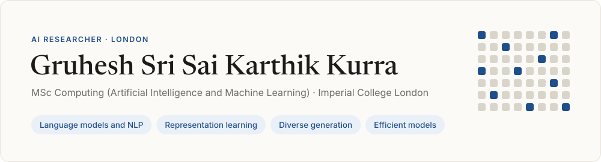

<a href="https://gruheshkurra.com">
  <picture>
    <source media="(prefers-color-scheme: dark)" srcset="assets/readme/header-dark.svg" />
    
  </picture>
</a>

<a href="https://gruheshkurra.com"><picture><source media="(prefers-color-scheme: dark)" srcset="assets/readme/link-website-dark.svg" /></picture></a>
<a href="https://gruheshkurra.com/assets/Resume.pdf"><picture><source media="(prefers-color-scheme: dark)" srcset="assets/readme/link-cv-dark.svg" /></picture></a>
<a href="https://scholar.google.com/citations?user=dwY966oAAAAJ"><picture><source media="(prefers-color-scheme: dark)" srcset="assets/readme/link-google-scholar-dark.svg" /></picture></a>
<a href="https://orcid.org/0009-0002-0558-2882"><picture><source media="(prefers-color-scheme: dark)" srcset="assets/readme/link-orcid-dark.svg" /></picture></a>
<a href="https://www.linkedin.com/in/gruheshkurra/"><picture><source media="(prefers-color-scheme: dark)" srcset="assets/readme/link-linkedin-dark.svg" /></picture></a>
<a href="mailto:gk326@ic.ac.uk"><picture><source media="(prefers-color-scheme: dark)" srcset="assets/readme/link-email-dark.svg" /></picture></a>

I'm an MSc student in Computing (Artificial Intelligence and Machine Learning) at Imperial College London, working on large language models and natural language processing. My papers so far ask how a model should represent words it has never seen, how one prompt can give several different answers instead of one, and how to store a network in much less memory without losing quality.

Before Imperial I studied Computer Science and Engineering at KL University, Hyderabad, and was a research intern at IIIT Hyderabad.

## News

<table>
<tr><td width="96" valign="top"><b>Oct 2026</b></td><td>Version 2 of <a href="https://doi.org/10.5281/zenodo.17217217">BIE</a> is on Zenodo, with a new storage format and a full measured evaluation.</td></tr>
<tr><td valign="top"><b>Sep 2026</b></td><td>Started the MSc in Computing (AI and Machine Learning) at Imperial College London.</td></tr>
<tr><td valign="top"><b>Jul 2026</b></td><td>My team won first place at Imperial's Global Challenge Lab, a 14-day sprint with over 1,000 students. I led the AI work on OrbitOps.</td></tr>
<tr><td valign="top"><b>2026</b></td><td>Dual-Stream and Prism Tuning accepted at IEEE NEPCON 2026.</td></tr>
<tr><td valign="top"><b>2025</b></td><td>MANCE published at IEEE ICCCMLA 2025.</td></tr>
</table>

## Publications

<table>
<tr>
<td width="220" valign="top"></td>
<td valign="top">
<b><a href="https://ieeexplore.ieee.org/document/11580466">Morphology-Aware Nested Character Embeddings for Word Representation</a></b> 
<b>Gruhesh Sri Sai Karthik Kurra</b>, Chandanasree Moparthi, Prathipati Manish Chowdary, Pavan Kumar Pagadala 
<picture><source media="(prefers-color-scheme: dark)" srcset="assets/readme/status-published-dark.svg" /></picture> <i>IEEE ICCCMLA 2025 · IEEE Xplore</i>

Each word vector is built from the word's characters by a small Transformer, so <i>play</i> and <i>plays</i> share most of their computation and an unseen word still gets a vector. In my seeded re-implementation (3 seeds) it reaches 63.0 F1 on GermEval 2014 German NER against 48.2 for word embeddings with the same encoder, and matches them on AG News and DBpedia.

<a href="https://ieeexplore.ieee.org/document/11580466"><picture><source media="(prefers-color-scheme: dark)" srcset="assets/readme/pub-paper-dark.svg" /></picture></a>
<a href="https://github.com/GruheshKurra/MANCE-NLP"><picture><source media="(prefers-color-scheme: dark)" srcset="assets/readme/pub-code-dark.svg" /></picture></a>
<a href="https://github.com/GruheshKurra/MANCE-NLP/blob/main/experiments/RESULTS.md"><picture><source media="(prefers-color-scheme: dark)" srcset="assets/readme/pub-results-dark.svg" /></picture></a>
</td>
</tr>
<tr>
<td width="220" valign="top"></td>
<td valign="top">
<b><a href="https://github.com/GruheshKurra/radar_deepfake">Dual-Stream Artifact Detection with Iterative Evidence Refinement for Frame-Level Deepfake Recognition</a></b> 
<b>Gruhesh Sri Sai Karthik Kurra</b>, Pavan Kumar Pagadala, Malathy Batumalay, Veda Boddapati 
<picture><source media="(prefers-color-scheme: dark)" srcset="assets/readme/status-accepted-dark.svg" /></picture> <i>IEEE NEPCON 2026 · presentation December 2026</i>

A ViT-Small detector with an edge stream for blending boundaries and a frequency stream for generator fingerprints, combined by iterative cross-attention. An audit found that 97.3% of WildDeepfake test frames came from videos also used in training, so the paper reports a video-disjoint subset of 5,680 frames: 96.3% AUC overall and 87.1% on Celeb-DF, from a single training run.

<a href="https://github.com/GruheshKurra/radar_deepfake"><picture><source media="(prefers-color-scheme: dark)" srcset="assets/readme/pub-code-dark.svg" /></picture></a>
<a href="https://www.kaggle.com/datasets/gruheshkurra/radar-deepfake-frames"><picture><source media="(prefers-color-scheme: dark)" srcset="assets/readme/pub-dataset-dark.svg" /></picture></a>
</td>
</tr>
<tr>
<td width="220" valign="top"></td>
<td valign="top">
<b>Prism Tuning: Repulsion-Trained Seed Embeddings in a Frozen Transformer for Non-Redundant Generation</b> 
<b>Gruhesh Sri Sai Karthik Kurra</b>, Pavan Kumar Pagadala, Malathy Batumalay, Sushma Reddy Koduru 
<picture><source media="(prefers-color-scheme: dark)" srcset="assets/readme/status-accepted-dark.svg" /></picture> <i>IEEE NEPCON 2026 · presentation December 2026</i>

K seed vectors are added to the input embeddings of a frozen transformer and trained only by a repulsion loss, so one prompt gives K different outputs in one batched pass, with no sampling and filtering at inference. The paper gives the method and its formulation; running the experiments is my next step.

</td>
</tr>
<tr>
<td width="220" valign="top"></td>
<td valign="top">
<b><a href="https://doi.org/10.5281/zenodo.17217217">BIE: Bit-Index Encoding of Sparse Neural Network Weights</a></b> 
<b>Gruhesh Sri Sai Karthik Kurra</b> 
<picture><source media="(prefers-color-scheme: dark)" srcset="assets/readme/status-preprint-dark.svg" /></picture> <i>Zenodo · version 2, October 2026</i>

A storage format for pruned weight matrices. The gaps between non-zero weights are Golomb–Rice coded, the values are 8-bit codes stored as bitplanes, and a row-parallel kernel multiplies on the compressed form. At 95% sparsity it is 44.5× smaller than float32 at 0.6% error, against 25.7× for CSR with the same values. Below about 50% sparsity it is no smaller than dense int8.

<a href="https://doi.org/10.5281/zenodo.17217217"><picture><source media="(prefers-color-scheme: dark)" srcset="assets/readme/pub-paper-dark.svg" /></picture></a>
<a href="https://github.com/GruheshKurra/bit-index-encoding-research-"><picture><source media="(prefers-color-scheme: dark)" srcset="assets/readme/pub-code-dark.svg" /></picture></a>
<a href="https://github.com/GruheshKurra/bit-index-encoding-research-/blob/main/experiments/RESULTS.md"><picture><source media="(prefers-color-scheme: dark)" srcset="assets/readme/pub-results-dark.svg" /></picture></a>
</td>
</tr>
</table>

The MANCE and BIE repositories include the configs, seeds and per-run result files behind the numbers above, so each one can be re-run.

## Experience

<table>
<tr>
<td width="64" valign="top"></td>
<td valign="top">
<b>AI Integration Engineer</b> · InfoAjax Consulting 
Oct – Nov 2025 · remote

Built a proof-of-concept browser agent that acts on screenshots using models on Azure AI Foundry, and a React and FastAPI console for watching agents live.

</td>
</tr>
<tr>
<td width="64" valign="top"></td>
<td valign="top">
<b>Research Intern</b> · IIIT Hyderabad 
Dec 2024 – Jun 2025 · Hyderabad

Built a document translation system for English, Hindi, Telugu and German that keeps the original page layout, using Vision Transformer layout detection, font detection, colour extraction and Tesseract OCR. Demonstrated it at the institute's research expo in May 2025 (<a href="https://youtu.be/rcvSuBcBjyg">demo</a>).

</td>
</tr>
<tr>
<td width="64" valign="top"></td>
<td valign="top">
<b>Software Engineer (freelance)</b> · InfoAjax Consulting 
Oct 2024 – Jun 2025 · remote

Built REST APIs in WSO2 Micro Integrator connecting the service-desk, billing and inventory systems of a Philippine telecoms company, and supported them in production.

</td>
</tr>
</table>

<table>
<tr>
<td width="50%" valign="top">
<h3>Education</h3>

<b>Imperial College London</b> MSc Computing (Artificial Intelligence and Machine Learning) 2026 – 2027

<b>KL University, Hyderabad</b> B.Tech Computer Science and Engineering 2021 – 2025 · CGPA 9.72 / 10

</td>
<td width="50%" valign="top">
<h3>Awards</h3>

<b>First place</b>, Global Challenge Lab 2026 Imperial College London. I led the AI and ML work for our team's project, OrbitOps, a reliability layer for AI running on satellites.

<b>First place</b>, University Webathon KL University, 2022

<b>Technical Lead</b>, Student Activity Council KL University, 2023 – 2025

</td>
</tr>
</table>

## Writing

I write [AI from Scratch](https://blogs.gruheshkurra.com/series/ai/), a blog series that takes one model at a time from its derivation to a working implementation. Recent posts:

<!-- BLOG-POST-LIST:START --><a href="https://blogs.gruheshkurra.com/blog/convolutional-neural-networks-explained/">Convolutional Neural Networks: CNN Math Explained</a> <a href="https://blogs.gruheshkurra.com/blog/deepseek-v4-inside-one-token/">DeepSeek V4 Inside: One Token Through Every Block</a> <a href="https://blogs.gruheshkurra.com/blog/looped-transformers-explained/">Looped Transformers Explained: Recurrent Depth and Astra</a> <a href="https://blogs.gruheshkurra.com/blog/natural-language-inference-explained/">Natural Language Inference Explained: Entailment in NLP</a> <a href="https://blogs.gruheshkurra.com/blog/build-mini-llm-numpy-from-scratch/">Build a Mini LLM from Scratch in NumPy: RoPE, GQA, SwiGLU</a> <!-- BLOG-POST-LIST:END -->

[All posts](https://blogs.gruheshkurra.com/ai-explanations/) · [RSS](https://blogs.gruheshkurra.com/feed.xml)

## Contact

I'm looking for funded PhD positions in language models and NLP starting from October 2027. Email me at [gk326@ic.ac.uk](mailto:gk326@ic.ac.uk).
