<table>
<tr>
<td width="200" valign="middle"></td>
<td valign="middle">
<h1>Gruhesh Sri Sai Karthik Kurra</h1>
MSc Computing (AI and Machine Learning) · <a href="https://www.imperial.ac.uk/computing">Imperial College London</a>  
     
</td>
</tr>
</table>

I'm an MSc student at Imperial, working on **large language models and natural language processing**. I look at how models represent words and meaning, how one prompt can give several different answers, and how to make models smaller without losing quality.

Before Imperial I studied Computer Science and Engineering at KL University, Hyderabad (CGPA 9.72 / 10). I was a research intern at IIIT Hyderabad, and I also built integration software for enterprise clients at InfoAjax.

I'm looking for funded PhD positions in language models and NLP, starting October 2027. Email me at [gk326@ic.ac.uk](mailto:gk326@ic.ac.uk).

## Experience and education

<table>
<tr>
<td width="120" valign="top">2026 – 2027</td>
<td width="64" valign="top">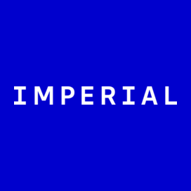</td>
<td valign="top"><b>MSc Computing (Artificial Intelligence and Machine Learning)</b> Imperial College London</td>
</tr>
<tr>
<td width="120" valign="top">Oct – Nov 2025</td>
<td width="64" valign="top"></td>
<td valign="top"><b>AI Integration Engineer</b> InfoAjax Consulting · remote I built a proof-of-concept browser agent that acts on screenshots, using models on Azure AI Foundry. I also built a React and FastAPI console to watch agents live.</td>
</tr>
<tr>
<td width="120" valign="top">Dec 2024 – Jun 2025</td>
<td width="64" valign="top">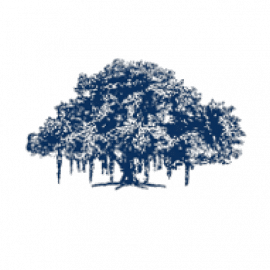</td>
<td valign="top"><b>Research Intern</b> IIIT Hyderabad I designed a document translation system for English, Hindi, Telugu and German that keeps the original layout. It uses Vision Transformer layout detection, font detection, colour extraction and Tesseract OCR. I demonstrated it at the institute's research expo (<a href="https://youtu.be/rcvSuBcBjyg">demo</a>).</td>
</tr>
<tr>
<td width="120" valign="top">Oct 2024 – Jun 2025</td>
<td width="64" valign="top"></td>
<td valign="top"><b>Software Engineer (freelance)</b> InfoAjax Consulting · remote I built REST APIs in WSO2 Micro Integrator that link the service-desk, billing and inventory systems of a Philippine telecoms company. I supported them in production.</td>
</tr>
<tr>
<td width="120" valign="top">2024</td>
<td width="64" valign="top">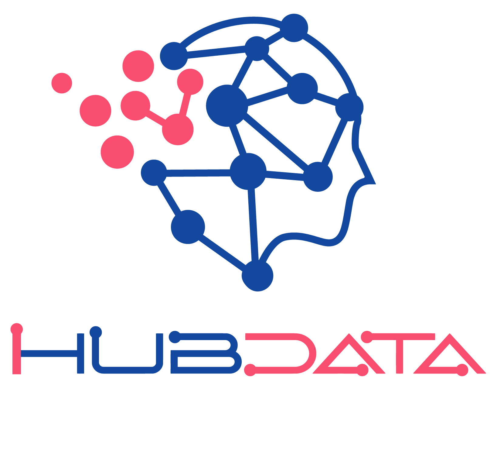</td>
<td valign="top"><b>Machine learning programme (six months)</b> iHub-Data, IIIT Hyderabad</td>
</tr>
<tr>
<td width="120" valign="top">2021 – 2025</td>
<td width="64" valign="top">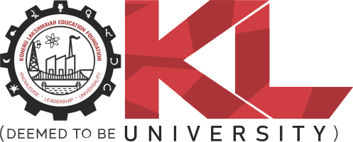</td>
<td valign="top"><b>B.Tech Computer Science and Engineering</b> KL University, Hyderabad · CGPA 9.72 / 10</td>
</tr>
</table>

## News

- **Oct 2026:** I tested a redesigned Prism Tuning in pre-registered GPU experiments. It gave no significant gain, and I have a suspected cause.
- **Oct 2026:** Version 2 of [BIE](https://doi.org/10.5281/zenodo.17217217) is on Zenodo. It has a new storage format and a full measured evaluation.
- **Sep 2026:** Started the MSc in Computing (AI and Machine Learning) at Imperial College London.
- **Jul 2026:** My team won **first place** at Imperial's Global Challenge Lab, a 14-day sprint with over 1,000 students. I led the AI work on OrbitOps, a reliability layer for satellite onboard AI.
- **2026:** Two papers, Dual-Stream and Prism Tuning, accepted at IEEE NEPCON 2026.
- **2025:** MANCE published at IEEE ICCCMLA 2025 (IEEE Xplore).

## Publications

<table>
<tr>
<td width="200" valign="top">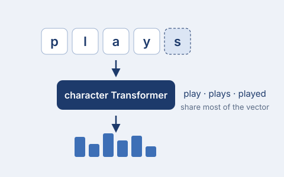</td>
<td valign="top"><b><a href="https://ieeexplore.ieee.org/document/11580466">Morphology-Aware Nested Character Embeddings for Word Representation</a></b> <b>Gruhesh Sri Sai Karthik Kurra</b>, Chandanasree Moparthi, Prathipati Manish Chowdary, Pavan Kumar Pagadala <i>IEEE ICCCMLA 2025 · Published in IEEE Xplore</i> A character-level Transformer builds every word from its characters. Related forms share part of their representation, and unseen words still get a vector. In a seeded re-implementation (3 seeds) it beats word embeddings by 14.9 F1 on German NER (63.0 vs 48.2) and is on par on English topic classification. <a href="https://ieeexplore.ieee.org/document/11580466">Paper</a> · <a href="https://github.com/GruheshKurra/MANCE-NLP">Code</a> · <a href="https://github.com/GruheshKurra/MANCE-NLP/blob/main/experiments/RESULTS.md">Results</a></td>
</tr>
<tr>
<td width="200" valign="top">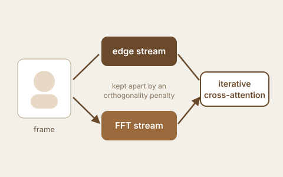</td>
<td valign="top"><b><a href="https://github.com/GruheshKurra/radar_deepfake">Dual-Stream Artifact Detection with Iterative Evidence Refinement for Frame-Level Deepfake Recognition</a></b> <b>Gruhesh Sri Sai Karthik Kurra</b>, Pavan Kumar Pagadala, Malathy Batumalay, Veda Boddapati <i>IEEE NEPCON 2026 · Accepted, presentation December 2026</i> A ViT-Small model with an edge stream for blending boundaries and a frequency stream for generator fingerprints, fused by iterative cross-attention. An audit found that 97.3% of WildDeepfake test frames came from videos also used in training. So the main result is 96.3% AUC on a video-disjoint subset of 5,680 frames (87.1% on Celeb-DF), from a single training run. <a href="https://github.com/GruheshKurra/radar_deepfake">Code</a> · <a href="https://www.kaggle.com/datasets/gruheshkurra/radar-deepfake-frames">Dataset</a></td>
</tr>
<tr>
<td width="200" valign="top">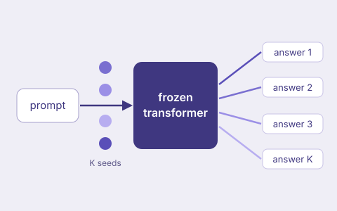</td>
<td valign="top"><b>Prism Tuning: Repulsion-Trained Seed Embeddings in a Frozen Transformer for Non-Redundant Generation</b> <b>Gruhesh Sri Sai Karthik Kurra</b>, Pavan Kumar Pagadala, Malathy Batumalay, Sushma Reddy Koduru <i>IEEE NEPCON 2026 · Accepted, presentation December 2026</i> Only K seed vectors are trained. They are added to the input embeddings of a frozen transformer and pushed apart by a repulsion loss, so one prompt gives K different answers in one batched pass, with no filtering. The paper gives the method and formulation only. In October 2026 I tested a redesigned version in pre-registered GPU experiments on Qwen2.5. It did not significantly beat tuned min-p sampling, and the main suspected cause is the training data. </td>
</tr>
<tr>
<td width="200" valign="top">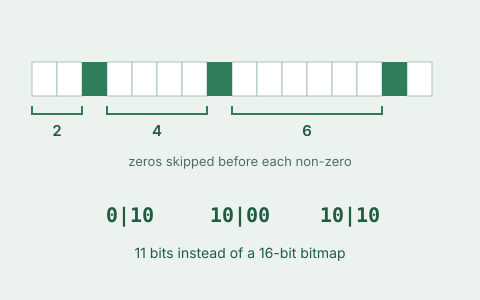</td>
<td valign="top"><b><a href="https://doi.org/10.5281/zenodo.17217217">BIE: Bit-Index Encoding of Sparse Neural Network Weights</a></b> <b>Gruhesh Sri Sai Karthik Kurra</b> <i>Zenodo preprint · Version 2, October 2026</i> A storage format for pruned weights. The gaps between non-zeros are Golomb-Rice coded and the values are 8-bit codes stored as bitplanes. At 95% sparsity it is 44.5× smaller than float32 at 0.6% error, against 25.7× for CSR with the same values. Below about 50% sparsity it is no smaller than dense int8. <a href="https://doi.org/10.5281/zenodo.17217217">Paper</a> · <a href="https://github.com/GruheshKurra/bit-index-encoding-research-">Code</a> · <a href="https://github.com/GruheshKurra/bit-index-encoding-research-/blob/main/experiments/RESULTS.md">Results</a></td>
</tr>
</table>

The MANCE and BIE repositories include the configs, seeds and per-run result files behind these numbers, so you can re-run each one. More on [Google Scholar](https://scholar.google.com/citations?user=dwY966oAAAAJ).

## Awards and service

- **First place**, Global Challenge Lab, Imperial College London, 2026
- **First place**, University Webathon, KL University, 2022
- **Technical Lead**, Student Activity Council, KL University, 2023 to 2025: mentored 20+ students and ran workshops for 100+
- Hackathon mentor, Anurag University, Hyderabad

## Certificates

<table>
<tr><td width="25%" valign="top" align="center"><a href="certificates/global-challenge-lab-2026.jpg">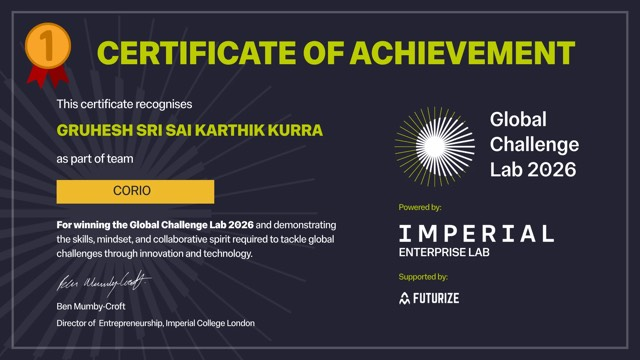</a> <b>Global Challenge Lab 2026, 1st place</b> Imperial College London · 2026</td><td width="25%" valign="top" align="center"><a href="certificates/tensorflow-developer.jpg">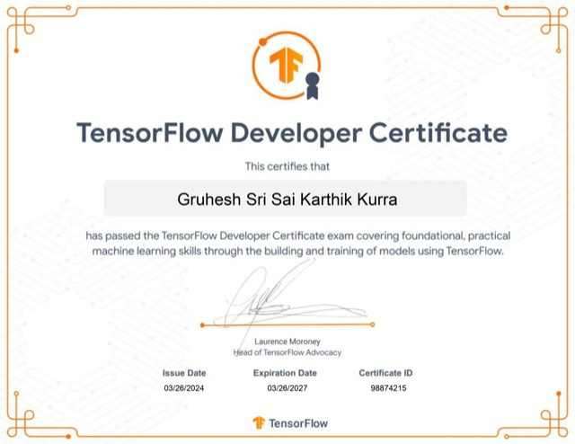</a> <b>TensorFlow Developer Certificate</b> Google · 2024</td><td width="25%" valign="top" align="center"><a href="certificates/aws-cloud-practitioner.jpg">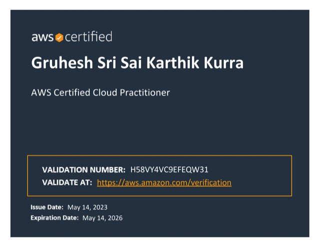</a> <b>AWS Certified Cloud Practitioner</b> Amazon Web Services · 2023 · expired May 2026</td><td width="25%" valign="top" align="center"><a href="certificates/aws-solutions-architect.jpg">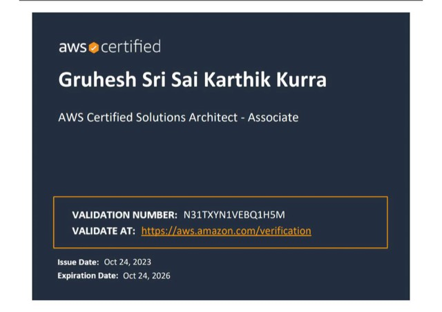</a> <b>AWS Certified Solutions Architect, Associate</b> Amazon Web Services · 2023 · expired Oct 2026</td></tr>
<tr><td width="25%" valign="top" align="center"><a href="certificates/oracle-architect.jpg">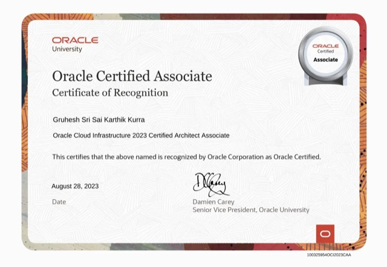</a> <b>Oracle Cloud Infrastructure Architect Associate</b> Oracle · 2023</td><td width="25%" valign="top" align="center"><a href="certificates/oracle-genai.jpg">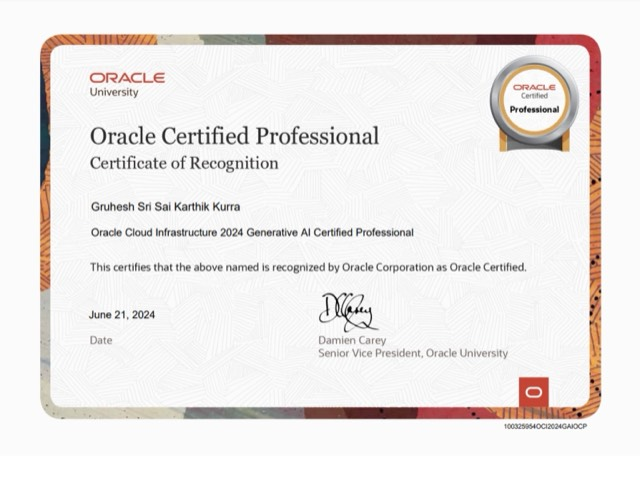</a> <b>Oracle Cloud Infrastructure Generative AI Professional</b> Oracle · 2024</td><td width="25%" valign="top" align="center"><a href="certificates/oracle-database.jpg">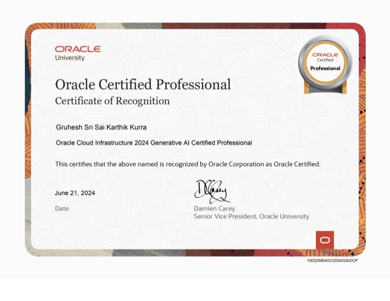</a> <b>Oracle Database Certificate</b> Oracle · 2023</td><td width="25%" valign="top" align="center"><a href="certificates/automation-anywhere.jpg">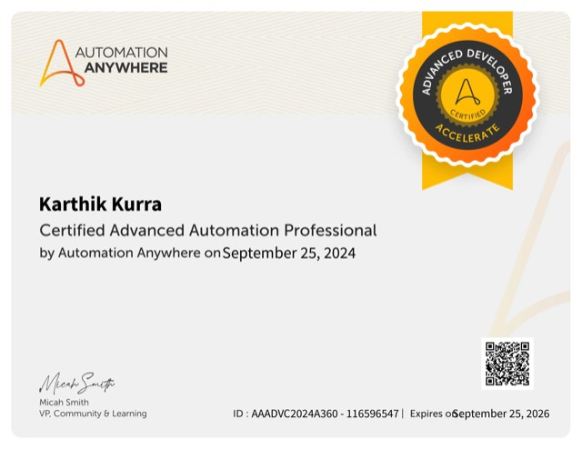</a> <b>Certified Advanced Automation Professional</b> Automation Anywhere · 2024 · expired Sep 2026</td></tr>
<tr><td width="25%" valign="top" align="center"><a href="certificates/redhat-developer.jpg">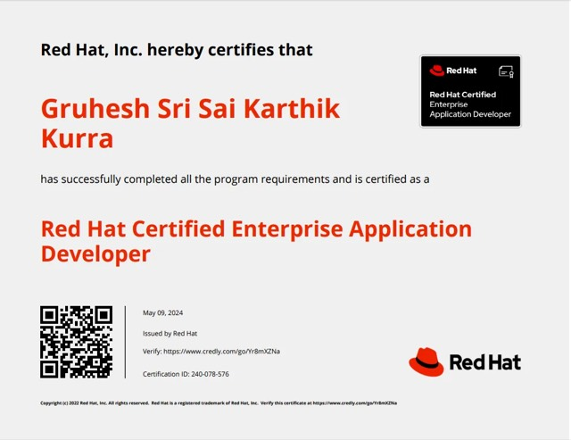</a> <b>Red Hat Certified Enterprise Application Developer</b> Red Hat · 2024</td><td width="25%" valign="top" align="center"> <b>WSO2 Certified Micro Integrator Developer, V4</b> WSO2 · 2025</td><td width="25%" valign="top" align="center"><a href="certificates/visuara-llms.jpg">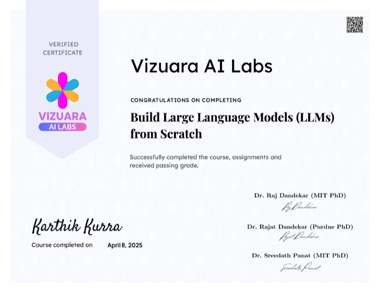</a> <b>Build Large Language Models From Scratch</b> Visuara · 2024</td><td width="25%" valign="top" align="center"><a href="certificates/hf-mcp-unit1.jpg">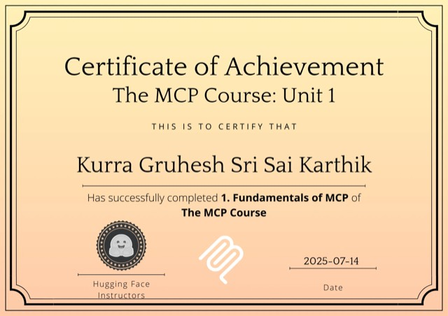</a> <b>Hugging Face MCP, Unit 1</b> Hugging Face · 2024</td></tr>
<tr><td width="25%" valign="top" align="center"><a href="certificates/hf-mcp-unit3.jpg">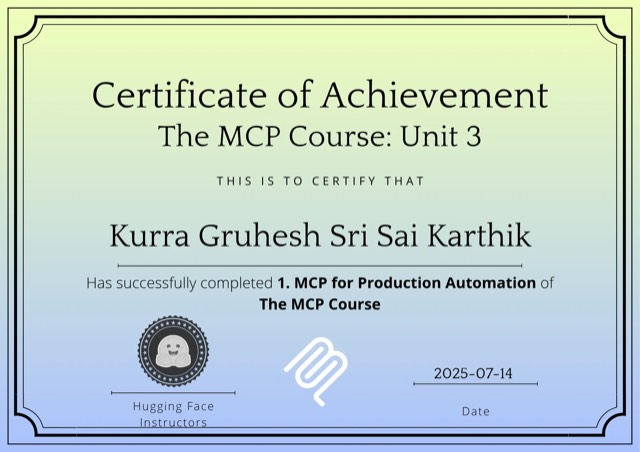</a> <b>Hugging Face MCP, Unit 3</b> Hugging Face · 2024</td><td width="25%" valign="top" align="center"><a href="certificates/iiit-training.jpg">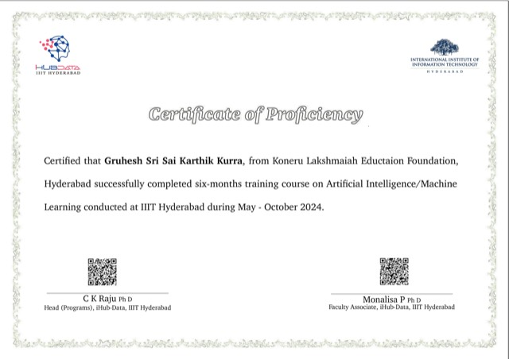</a> <b>IIIT Hyderabad 6-Month AI/ML Training</b> IIIT Hyderabad · 2024</td><td width="25%" valign="top" align="center"><a href="certificates/sac-appreciation.jpg">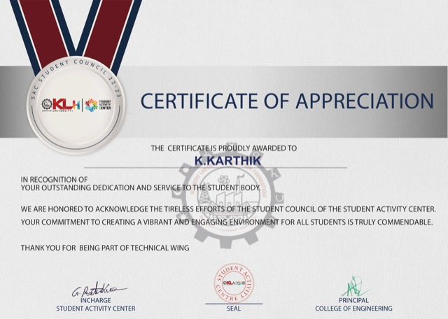</a> <b>Certificate of Appreciation, Student Activity Center</b> KL University · 2022 to 2023</td><td width="25%" valign="top" align="center"><a href="certificates/streetcause.jpg">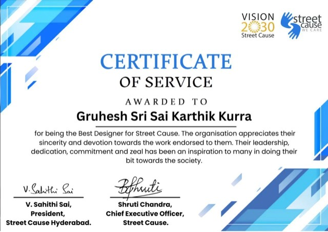</a> <b>Certificate of Service, Volunteer</b> Street Cause NGO · 2023 to 2024</td></tr>
<tr><td width="25%" valign="top" align="center"><a href="certificates/wso2-mi-practitioner.jpg">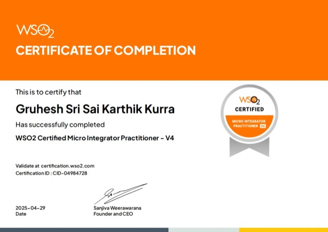</a> <b>WSO2 Certified Micro Integrator Practitioner, V4</b> WSO2 · 2025</td><td width="25%" valign="top" align="center"><a href="certificates/google-gdg.jpg">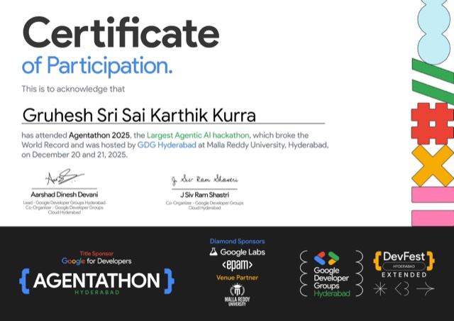</a> <b>Google GDG Certificate</b> Google Developer Groups · 2025</td><td width="25%" valign="top" align="center"><a href="certificates/udemy-linear-algebra.jpg">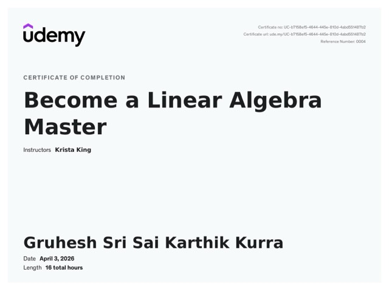</a> <b>Become a Linear Algebra Master</b> Udemy · 2026</td><td width="25%" valign="top" align="center"><a href="certificates/udemy-deep-learning.jpg">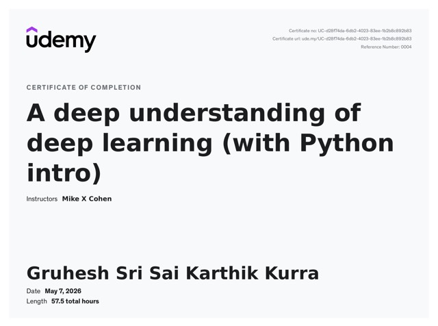</a> <b>A Deep Understanding of Deep Learning (with Python)</b> Udemy · 2026</td></tr>
</table>

## Skills

**Programming languages:** Python, JavaScript, TypeScript, Swift, Java, C, C++, R, SQL, PHP, HTML, CSS, Shell 
**AI / ML frameworks:** PyTorch, TensorFlow, Hugging Face, LangChain, LlamaIndex, scikit-learn, PyTorch Geometric, Gradio, Streamlit, UMAP 
**AI / ML specialisations:** LLM optimisation, SLM fine-tuning, RAG, prompt engineering, Transformers, attention mechanisms, GANs, VAEs, diffusion models, GNNs, on-device AI, deepfake detection, quantisation, pruning, distillation 
**Computer vision:** EfficientNet, Vision Transformer, MediaPipe, OpenCV, Tesseract, CLIP, document analysis, OCR 
**iOS / mobile:** Swift, SwiftUI, Core ML, iOS development, Vision framework, AVFoundation, Core Data, Metal MPS, on-device inference 
**Web and backend:** React.js, Next.js, FastAPI, Node.js, Express.js, TailwindCSS, Vite, React Native, WebSocket, REST APIs 
**Cloud and DevOps:** AWS, Azure OpenAI, Azure AD, Google Cloud, Docker, Vercel, WSO2, CI/CD, Git, GitLab, serverless 
**Databases and data science:** PostgreSQL, MySQL, MongoDB, Redis, Firebase, Supabase, Pandas, NumPy, Matplotlib, FAISS, synthetic data 

## Writing

I write [AI from Scratch](https://blogs.gruheshkurra.com/series/ai/), a blog series that derives machine learning models from the maths to the training loop. Recent posts:

<!-- BLOG-POST-LIST:START --><a href="https://blogs.gruheshkurra.com/blog/colibri-llm-engine-explained/">Colibri Explained: How a 744B LLM Runs From Disk</a> <a href="https://blogs.gruheshkurra.com/blog/convolutional-neural-networks-explained/">Convolutional Neural Networks: CNN Math Explained</a> <a href="https://blogs.gruheshkurra.com/blog/deepseek-v4-inside-one-token/">DeepSeek V4 Inside: One Token Through Every Block</a> <a href="https://blogs.gruheshkurra.com/blog/looped-transformers-explained/">Looped Transformers Explained: Recurrent Depth and Astra</a> <a href="https://blogs.gruheshkurra.com/blog/natural-language-inference-explained/">Natural Language Inference Explained: Entailment in NLP</a> <!-- BLOG-POST-LIST:END -->

[All posts](https://blogs.gruheshkurra.com/ai-explanations/) · [RSS](https://blogs.gruheshkurra.com/feed.xml)
